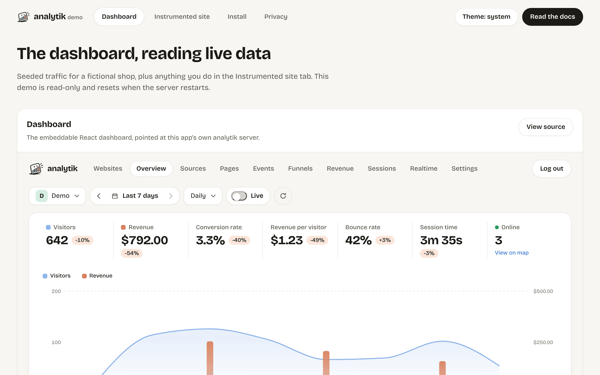
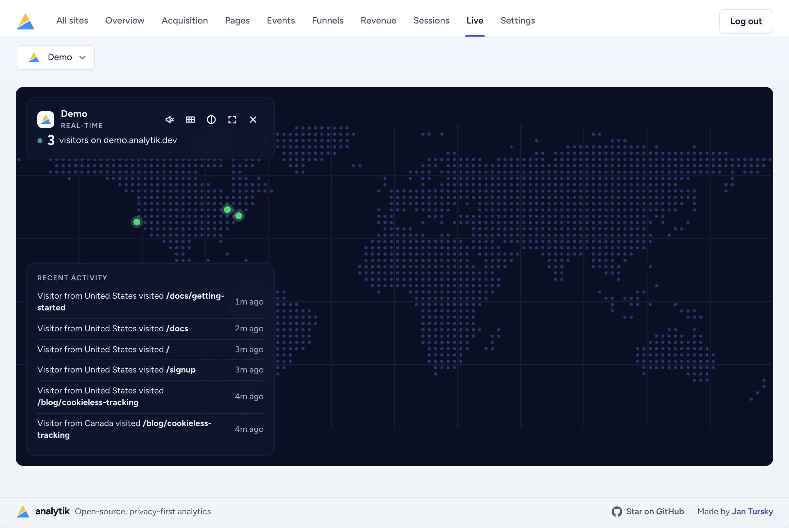
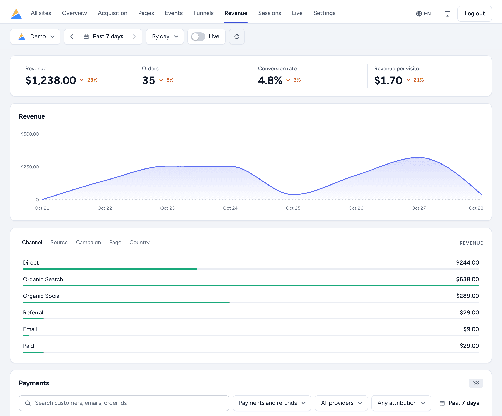

<p align="center">
  
</p>

<p align="center">
  <a href="https://www.npmjs.com/package/analytik"></a>
  <a href="https://github.com/jantursky/analytik/actions/workflows/ci.yml"></a>
  <a href="https://codecov.io/gh/jantursky/analytik"></a>
  
  <a href="LICENSE"></a>
</p>

<p align="center">
  <a href="https://analytik-docs.vercel.app">Docs</a> ·
  <a href="https://analytik.vercel.app">Demo</a> ·
  <a href="https://www.npmjs.com/package/analytik">npm</a> ·
  <a href="packages/analytik/CHANGELOG.md">Changelog</a>
</p>

# Analytik

Web analytics you host yourself. The default `strict` mode is designed to avoid needing a cookie banner (see the [privacy page](https://analytik-docs.vercel.app/concepts/privacy-modes) for the conditions). A Hono server for Cloudflare Workers, Vercel, Railway, Bun or Node, storage on D1, Postgres (Supabase) or SQLite, a 4 KB tracker, React bindings and a dashboard you can embed.

<a href="https://analytik.vercel.app/#dashboard">
  <picture>
    <source media="(prefers-color-scheme: dark)" srcset=".github/assets/dashboard-dark.png">
    
  </picture>
</a>

<p>
<a href="https://analytik.vercel.app/#dashboard"><picture>
  <source media="(prefers-color-scheme: dark)" srcset=".github/assets/live-dark.png">
  
</picture></a>
<a href="https://analytik.vercel.app/#dashboard"><picture>
  <source media="(prefers-color-scheme: dark)" srcset=".github/assets/revenue-dark.png">
  
</picture></a>
</p>

The demo also shows [how each privacy mode works](https://analytik.vercel.app/#privacy) and a [shop wired up with the React bindings](https://analytik.vercel.app/#site).

## What you get

- **Strict mode by default.** The tracker stores no identifier on the visitor's device and no IP address is kept. The visitor id is a pseudonymous hash of IP, user agent and site, salted with a random value that is removed from the live database once the next month starts. Do Not Track visitors are still counted, in strict mode. Strict mode is designed to avoid needing consent, which is not legal advice.
- **Two more modes when you need them.** `enriched` adds a per-tab id after the visitor consents. `persistent` uses first-party cookies like most analytics tools do, and should be treated as needing consent in the EU.
- **Revenue.** A payments API with refunds, optional Stripe, Dodo and Lemon Squeezy webhook adapters, and attribution to the visit that brought the buyer.
- **Goals, funnels, campaigns, realtime**, JSON and CSV export, retention, share links (read-only, set through the API).
- **One server, three databases.** It runs on D1, Postgres and SQLite, and the tests run every case against each of them.

## Install

```sh
bun add analytik hono
```

## A server in a dozen lines

```ts sample
import { createAnalytik } from 'analytik/server'
import { d1Storage } from 'analytik/storage/d1'

interface Env {
  DB: Parameters<typeof d1Storage>[0]
  ADMIN_PASSWORD: string
  SESSION_SECRET: string
}

export default {
  fetch(request: Request, env: Env) {
    const { app } = createAnalytik({
      storage: d1Storage(env.DB),
      admin: { password: env.ADMIN_PASSWORD, secret: env.SESSION_SECRET },
    })
    return app.fetch(request, env)
  },
}
```

Then add the tracker to your site:

```html
<script defer src="https://analytics.example.com/js/analytik.js" data-site="my-site" data-mode="strict"></script>
```

Track an event or a sale from your own code:

```ts sample
import { createClient } from 'analytik/client'

const analytik = createClient({ site: 'my-site', api: 'https://analytics.example.com/api' })

analytik.track('signup', { plan: 'pro' })
analytik.revenue('purchase', 49.9, { currency: 'EUR', orderId: '1042' })
```

## How it works

1. The tracker (`packages/analytik/src/tracker`) sends pageviews, engaged time, outbound clicks and your events to `POST /api/event`, using a `text/plain` beacon so no preflight is needed.
2. The server (`packages/analytik/src/server`) checks the origin against the site's domain, drops bots, and computes the visitor id with the monthly salt.
3. Sessions, events and payments land in the storage adapter you chose (`packages/analytik/src/storage`).
4. Payments arrive through `POST /api/v1/payments` or a provider webhook (`packages/analytik/src/adapters`) and are matched to the visit that led to them.
5. The dashboard (`packages/analytik/src/dashboard`) reads the admin API. Embed `<Dashboard />` in your own app or use the one in the demo.

## Deploy

| Where                                                                                   | Storage                   | Good for                                |
| --------------------------------------------------------------------------------------- | ------------------------- | --------------------------------------- |
| [**Cloudflare Workers**](https://analytik-docs.vercel.app/deploy/cloudflare-workers-d1) | D1                        | The free plan, no server to run (below) |
| [**Vercel**](https://analytik-docs.vercel.app/deploy/vercel-supabase)                   | Supabase or Neon Postgres | Already hosting your site on Vercel     |
| [**Railway**](https://analytik-docs.vercel.app/deploy/railway-postgres)                 | Railway Postgres          | A long-running service with a database  |
| [**Bun or Node**](https://analytik-docs.vercel.app/deploy/bun-node-sqlite)              | SQLite file               | A VPS or a Docker container             |

### Cloudflare in one command

```bash
npx analytik@latest create my-stats
```

It installs the packages, signs you in to Cloudflare, creates the D1 database, deploys a Worker that serves the dashboard, the tracker and the API, and sets the secrets. You get the address and a dashboard password at the end: open it, sign in, add your site and paste the snippet. A small site fits Cloudflare's free plan.

**Prefer to click?**

**Cloudflare** (Workers and D1)<br>
[](https://deploy.workers.cloudflare.com/?url=https://github.com/jantursky/analytik/tree/main/packages/analytik/templates/cloudflare)

**Vercel** (a function with Postgres)<br>
[](https://vercel.com/new/clone?repository-url=https%3A%2F%2Fgithub.com%2Fjantursky%2Fanalytik&root-directory=packages%2Fanalytik%2Ftemplates%2Fvercel&project-name=analytik&env=DATABASE_URL,ADMIN_PASSWORD,SESSION_SECRET&envDescription=A%20pooled%20Postgres%20URL%2C%20the%20dashboard%20password%20and%2032%2B%20random%20characters)

The Cloudflare button copies the template to your GitHub and deploys it, and asks for two values on its screen: `ADMIN_PASSWORD` (the password you will sign in with) and `SESSION_SECRET` (32 or more random characters, `openssl rand -hex 32`). The Vercel one does the same for a function with Postgres (Supabase or Neon) and asks for the connection string and the two secrets. `npx analytik@latest create my-stats --target vercel` writes the Vercel project to deploy yourself.

The Worker is a few lines. The dashboard is built into `analytik/standalone`, so there is no app to build:

```ts
import { createAnalytik } from 'analytik/server'
import { withDashboard } from 'analytik/standalone'
import { d1Storage } from 'analytik/storage/d1'

interface Env {
  DB: D1Database
  ADMIN_PASSWORD: string
  SESSION_SECRET: string
}

let handler: ReturnType<typeof withDashboard<[Env, ExecutionContext]>> | undefined

export default {
  fetch(request: Request, env: Env, ctx: ExecutionContext) {
    handler ??= withDashboard(
      createAnalytik({
        storage: d1Storage(env.DB),
        admin: { password: env.ADMIN_PASSWORD, secret: env.SESSION_SECRET },
      }).app,
    )
    return handler.fetch(request, env, ctx)
  },
}
```

The [Cloudflare guide](https://analytik-docs.vercel.app/deploy/cloudflare-workers-d1) has the manual steps, a custom domain, the free-plan limits and a first-party route for ad blockers. To put the dashboard inside your own React app instead, see [embedding the dashboard](https://analytik-docs.vercel.app/guides/dashboard-embedding).

## Alternatives

[Plausible](https://plausible.io) and [Umami](https://umami.is) are good, mature alternatives if you prefer a bigger project.

## Support

Browsers: the tracker targets ES2020, so any evergreen browser. Runtimes: Cloudflare Workers, Bun 1.3+, Node 22.19+, Vercel Functions. The dashboard and React bindings need React 19.

## Development

```sh
bun install
bun run check      # samples, format, lint, typecheck, tests with coverage
bun run dev        # the demo app
bun run dev:docs   # the docs site
```

See [CONTRIBUTING.md](CONTRIBUTING.md). Security notes are in [SECURITY.md](SECURITY.md).

## License

[MIT](LICENSE)
